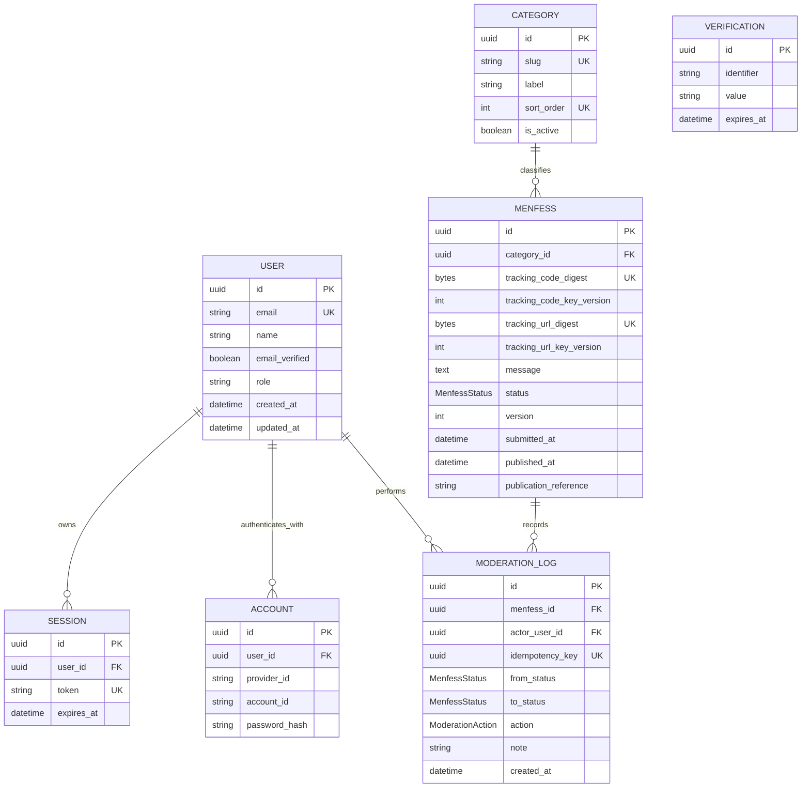

# Bawean Menfess — Database Architecture

## 1. Scope and status

- Task: D1 Task 1.1 — database architecture and schema planning
- Status: approved architecture; initial migration deployed during D1.3F-R4;
  admin-only authentication implemented during D1.4–D1.6
- Database: PostgreSQL on Supabase
- Data access: Prisma ORM 7 from trusted Next.js server code
- Authentication: Better Auth for administrators only
- Inspected package baseline: Prisma `7.10.1`, Better Auth `1.7.12`, and
  `@supabase/supabase-js` `2.118.0`
- Last reviewed: 21 October 2026

This document reconciles the repository's D0 specification with the original
approved product decisions. The approved decisions take precedence where the
two differ. Figma remains the visual source, not authority to invent persistent
fields or workflow states.

## 2. Requirement reconciliation

| Area | Repository/Figma baseline | Approved decision | Task 1.1 resolution |
| --- | --- | --- | --- |
| Categories | `Curhat`, `Tanya`, `Apresiasi`, `Info` | `Confess`, `Curhat`, `Ask BM`, `Connect`, `Discuss` | Use the five approved categories. The old four are not aliases. |
| Statuses | `received`, `in_review`, `approved`, `published`, `rejected` | `PENDING`, `APPROVED`, `REJECTED`, `PUBLISHED` | Persist only the four approved states. `Diterima` and `Dalam moderasi` are presentation labels for `PENDING`, not separate states. |
| Visitors | Anonymous, no public account | Anonymous, no visitor accounts | `Menfess` has no visitor/user foreign key. |
| Tracking | Figma shows one short `BM-XXXXXXXX` code | Separate human-readable code and secure URL token; both private | Generate independent high-entropy credentials, return each once, and persist only separate HMAC digests and key versions. |
| Admin list identifier | D0 text says to display the tracking code | Tracking credentials are private and one-way stored | Use the internal UUID unless a separate non-secret reference is later approved; never reveal either credential to staff. |
| Publication | Manual or API was open | Manual Instagram publication | `PUBLISHED` is set by an authenticated administrator and may store an Instagram reference. No Instagram API model is needed. |
| Audit | Moderation event concept | Moderation audit logs required | Append one immutable log per status transition, with actor and idempotency key. |
| Pseudonym | Optional field in Figma and D0 text | Not included in the listed approved decisions | Unresolved. The base schema omits it for data minimization. If approved before migration, add a nullable, length-constrained field and define display/retention rules. |

The reconciliation above is also reflected in
[`PROJECT_SPECIFICATION.md`](PROJECT_SPECIFICATION.md).

## 3. Architecture decisions

### 3.1 Database namespaces and access path

Use a dedicated PostgreSQL schema named `app_private` for both application and
Better Auth tables. Do not use Supabase's reserved `auth` schema. Do not expose
`app_private` through the Supabase Data API. The browser talks only to validated
Next.js endpoints; Prisma is server-only.

Use separate database roles and connection strings when implementation begins:

- A migration/owner role over a direct connection for Prisma Migrate.
- A least-privileged runtime role over the Supabase transaction pooler for
  Vercel functions.
- No grants on `app_private` to Supabase `anon` or `authenticated` roles.

If a future feature intentionally uses the Data API, put only its narrow API
surface in a separate exposed schema and protect it with explicit grants and
RLS. Do not expose these base tables.

Better Auth sessions do not populate Supabase Auth's `auth.uid()`. Do not try to
use Supabase Auth RLS as the administrator authorization boundary. Authorization
belongs in trusted server code; PostgreSQL roles and grants provide database
least privilege. Future Data API objects would need their own deliberate RLS
design.

### 3.2 Identifier and time conventions

- UUID primary keys for domain and auth records, represented as Prisma
  `String @db.Uuid` values.
- Better Auth must be configured for UUID ID generation so its generated schema
  agrees with PostgreSQL and Prisma.
- `timestamptz` semantics for all instants; application display uses the
  relevant locale/time zone.
- Physical table and column names use `snake_case`; Prisma model/field names use
  idiomatic PascalCase/camelCase mappings.

### 3.3 Category strategy

`Category` is a reference table rather than a PostgreSQL/Prisma enum. Seed it
idempotently with these immutable slugs:

| Slug | Display label | Sort order |
| --- | --- | ---: |
| `confess` | Confess | 1 |
| `curhat` | Curhat | 2 |
| `ask-bm` | Ask BM | 3 |
| `connect` | Connect | 4 |
| `discuss` | Discuss | 5 |

Slugs and historical rows are not renamed or deleted casually. `isActive`
allows a category to stop accepting new submissions without breaking history.

## 4. Entity relationships



`Verification` has no domain relationship; Better Auth consumes it by
identifier. A menfess deliberately has no relationship to `User`.

## 5. Conceptual Prisma models

This section remains the Task 1.1 review contract. Task 1.3A generated the auth
portion with the exact installed Better Auth CLI, reconciled it against this
contract, and implemented the executable schema in `prisma/schema.prisma`.

```prisma
generator client {
  provider = "prisma-client"
  output   = "../src/generated/prisma"
}

datasource db {
  provider = "postgresql"
  schemas  = ["app_private"]
}

enum MenfessStatus {
  PENDING
  APPROVED
  REJECTED
  PUBLISHED

  @@schema("app_private")
}

enum ModerationAction {
  APPROVE
  REJECT
  MARK_PUBLISHED

  @@schema("app_private")
}

model User {
  id            String   @id @default(uuid()) @db.Uuid
  name          String   @db.VarChar(120)
  email         String   @unique @db.VarChar(320)
  emailVerified Boolean  @default(false) @map("email_verified")
  image         String?
  role          String   @default("none") @db.VarChar(32)
  createdAt     DateTime @default(now()) @map("created_at") @db.Timestamptz(6)
  updatedAt     DateTime @updatedAt @map("updated_at") @db.Timestamptz(6)
  sessions      Session[]
  accounts      Account[]
  moderationLogs ModerationLog[]

  @@map("auth_user")
  @@schema("app_private")
}

model Session {
  id        String   @id @default(uuid()) @db.Uuid
  userId    String   @map("user_id") @db.Uuid
  token     String   @unique
  expiresAt DateTime @map("expires_at") @db.Timestamptz(6)
  ipAddress String?  @map("ip_address")
  userAgent String?  @map("user_agent")
  createdAt DateTime @default(now()) @map("created_at") @db.Timestamptz(6)
  updatedAt DateTime @updatedAt @map("updated_at") @db.Timestamptz(6)
  user      User     @relation(fields: [userId], references: [id], onDelete: Cascade)

  @@index([userId])
  @@index([expiresAt])
  @@map("auth_session")
  @@schema("app_private")
}

model Account {
  id                    String    @id @default(uuid()) @db.Uuid
  userId                String    @map("user_id") @db.Uuid
  accountId             String    @map("account_id")
  providerId            String    @map("provider_id")
  accessToken           String?   @map("access_token")
  refreshToken          String?   @map("refresh_token")
  idToken               String?   @map("id_token")
  accessTokenExpiresAt  DateTime? @map("access_token_expires_at") @db.Timestamptz(6)
  refreshTokenExpiresAt DateTime? @map("refresh_token_expires_at") @db.Timestamptz(6)
  scope                 String?
  password              String?
  createdAt             DateTime  @default(now()) @map("created_at") @db.Timestamptz(6)
  updatedAt             DateTime  @updatedAt @map("updated_at") @db.Timestamptz(6)
  user                  User      @relation(fields: [userId], references: [id], onDelete: Cascade)

  @@unique([providerId, accountId])
  @@index([userId])
  @@map("auth_account")
  @@schema("app_private")
}

model Verification {
  id         String   @id @default(uuid()) @db.Uuid
  identifier String
  value      String
  expiresAt  DateTime @map("expires_at") @db.Timestamptz(6)
  createdAt  DateTime @default(now()) @map("created_at") @db.Timestamptz(6)
  updatedAt  DateTime @updatedAt @map("updated_at") @db.Timestamptz(6)

  @@index([identifier])
  @@index([expiresAt])
  @@map("auth_verification")
  @@schema("app_private")
}

model Category {
  id        String    @id @default(uuid()) @db.Uuid
  slug      String    @unique @db.VarChar(32)
  label     String    @db.VarChar(50)
  sortOrder Int       @unique @map("sort_order") @db.SmallInt
  isActive  Boolean   @default(true) @map("is_active")
  createdAt DateTime  @default(now()) @map("created_at") @db.Timestamptz(6)
  updatedAt DateTime  @updatedAt @map("updated_at") @db.Timestamptz(6)
  menfess   Menfess[]

  @@map("category")
  @@schema("app_private")
}

model Menfess {
  id                   String         @id @default(uuid()) @db.Uuid
  categoryId           String         @map("category_id") @db.Uuid
  message              String         @db.VarChar(1000)
  trackingCodeDigest   Bytes          @unique @map("tracking_code_digest") @db.ByteA
  trackingCodeKeyVersion Int          @map("tracking_code_key_version") @db.SmallInt
  trackingUrlDigest    Bytes          @unique @map("tracking_url_digest") @db.ByteA
  trackingUrlKeyVersion Int           @map("tracking_url_key_version") @db.SmallInt
  status               MenfessStatus  @default(PENDING)
  version              Int            @default(0)
  submittedAt          DateTime       @default(now()) @map("submitted_at") @db.Timestamptz(6)
  updatedAt            DateTime       @updatedAt @map("updated_at") @db.Timestamptz(6)
  publishedAt          DateTime?      @map("published_at") @db.Timestamptz(6)
  publicationReference String?        @map("publication_reference") @db.VarChar(500)
  category             Category       @relation(fields: [categoryId], references: [id], onDelete: Restrict)
  moderationLogs       ModerationLog[]

  @@index([status, submittedAt(sort: Desc)])
  @@index([categoryId, submittedAt(sort: Desc)])
  @@map("menfess")
  @@schema("app_private")
}

model ModerationLog {
  id             String           @id @default(uuid()) @db.Uuid
  menfessId      String           @map("menfess_id") @db.Uuid
  actorUserId    String           @map("actor_user_id") @db.Uuid
  idempotencyKey String           @unique @map("idempotency_key") @db.Uuid
  action         ModerationAction
  fromStatus     MenfessStatus    @map("from_status")
  toStatus       MenfessStatus    @map("to_status")
  note           String?          @db.VarChar(1000)
  createdAt      DateTime         @default(now()) @map("created_at") @db.Timestamptz(6)
  menfess        Menfess          @relation(fields: [menfessId], references: [id], onDelete: Restrict)
  actor          User             @relation(fields: [actorUserId], references: [id], onDelete: Restrict)

  @@index([menfessId, createdAt(sort: Desc)])
  @@index([actorUserId, createdAt(sort: Desc)])
  @@index([toStatus, createdAt(sort: Desc)])
  @@map("moderation_log")
  @@schema("app_private")
}
```

The `role` field is a server-owned Better Auth additional field. It must use
`input: false`; `none` is the non-privileged default and only the exact value
`admin` grants application access. If the Better Auth Admin plugin is later
selected, regenerate the schema and review its additional `banned`,
`banReason`, `banExpires`, and `impersonatedBy` fields and its broader account
management endpoints. The plugin is not required merely to authorize the
Bawean Menfess dashboard.

The unapproved pseudonym is intentionally absent. If approved before migration,
the additive proposal is `pseudonym String? @db.VarChar(<approved limit>)` on
`Menfess`; it must never be treated as verified identity.

## 6. Constraints not fully expressible in Prisma

Task 1.3A added these as explicit SQL in the initial migration deployed during
D1.3F-R4:

- `message` is nonblank after trimming and has 1–1,000 characters.
- Both tracking digests are exactly 32 bytes and both key versions are greater
  than zero.
- `version >= 0` and `sort_order > 0`.
- `role IN ('none', 'admin')` unless a later role model is approved.
- A `PUBLISHED` menfess has `published_at`; all other states have
  `published_at IS NULL`.
- `action`, `from_status`, and `to_status` form only an approved transition.
- `moderation_log` rejects `UPDATE` and `DELETE` through an append-only trigger
  or equivalent database privileges.
- A partial pending-queue index on `(submitted_at DESC) WHERE status =
  'PENDING'` may replace the general status index after query-plan measurement.

Category membership is enforced by the foreign key, not duplicated as an enum.
Application validation must also reject inactive categories on new submissions.

## 7. Status transitions and transactional behavior

| From | Action | To | Additional write |
| --- | --- | --- | --- |
| `PENDING` | `APPROVE` | `APPROVED` | Append moderation log. |
| `PENDING` | `REJECT` | `REJECTED` | Append moderation log; optional internal note. |
| `APPROVED` | `MARK_PUBLISHED` | `PUBLISHED` | Set `publishedAt`, optional publication reference, and append log. |

Every action runs in one database transaction:

1. Validate the authenticated admin and requested transition.
2. Update `Menfess` with predicates on `id`, `status`, and `version`; increment
   `version`.
3. Require exactly one updated row, otherwise return a stale/conflict result.
4. Insert `ModerationLog` with the caller-supplied UUID idempotency key.
5. Commit both writes together.

The unique idempotency key makes a retried admin request safe. No direct status
update is allowed outside this service transaction. Reopen/reverse transitions
are not approved and remain unavailable.

## 8. Secure anonymous tracking

### 8.1 Generation and storage

Generate two independent credentials with Node/Web Crypto's cryptographically
secure random generator:

1. **Human-readable code:** the architecture recommendation is at least 100
   random bits encoded with an ambiguity-resistant alphabet such as Crockford
   Base32 and grouped for transcription. A possible presentation is
   `BM-XXXX-XXXX-XXXX-XXXX-XXXX`; the final alphabet/grouping is a product
   decision, not an approved requirement.
2. **Secure URL token:** 32 random bytes encoded as unpadded base64url, for
   example `bmu_` plus 43 encoded characters.

Return both only once. Apply domain-separated HMAC-SHA-256 operations (separate
keys, or an approved key-derivation/context scheme) and store only
`trackingCodeDigest`, `trackingCodeKeyVersion`, `trackingUrlDigest`, and
`trackingUrlKeyVersion`. Never persist either plaintext credential.

The HMAC keys are server-only secrets separate from the database and Better
Auth secret. Keep versioned active/legacy keys in the deployment secret
manager. For lookup, validate the credential type and format, compute a digest
for each accepted version of that type, and query its unique digest index. Key
rotation cannot re-HMAC old rows without plaintext, so legacy key material must
remain until the associated submissions expire or are deleted.

### 8.2 Lookup controls

- Accept a manually entered code in a POST body, never a query string, cookie,
  or log.
- Prefer a URL fragment for the link token (for example `/track#t=...`) so the
  browser does not send it in the initial request. Client code should remove
  the fragment and exchange the token through a redacted POST request. If a
  later implementation chooses a path token, it must prove proxy, hosting,
  analytics, history, and referrer redaction before approval.
- Return only the approved tracking projection: status and non-sensitive public
  timestamps/copy. Do not return message, pseudonym, notes, actor, digest, or
  publication internals.
- Use the same generic not-found response for invalid and unknown credentials.
- Rate-limit by privacy-conscious, short-lived abuse keys in Upstash Redis.
- Redact request bodies and tracking credentials from observability tooling.
- Do not offer recovery until an approved identity/recovery mechanism exists.

HMAC does not compensate for weak credentials. The code's minimum entropy and
the URL token's 256 random bits are the primary protections against guessing;
HMAC adds defense if the database is exposed and provides a rotation boundary.

## 9. Administrator authentication and authorization

- Enable Better Auth email/password sign-in for administrators only.
- Set `emailAndPassword.disableSignUp: true`; do not create visitor accounts.
- Provision administrators through a controlled, audited, server-side process.
- Configure UUID IDs and generate the core `User`, `Session`, `Account`, and
  `Verification` schema from Better Auth 1.7.12 before migration.
- Make `role` server-owned with non-admin default `none`; never accept it from
  signup/profile input. Every dashboard page, server action, and route handler
  must validate the live session and exact `admin` role server-side.
- Prefer deactivation/session revocation over hard-deleting administrators so
  moderation actor foreign keys and audit history remain intact.
- Use secure, HTTP-only, same-site cookies; short reasonable session lifetime,
  login throttling, generic credential errors, and session revocation after
  password reset. MFA and recovery remain product/security decisions before
  production.

Authentication proves the actor; authorization is still checked at each
operation. Neither a hidden route nor the existence of a Better Auth session is
sufficient authorization.

## 10. Supabase and Prisma integration plan

- Supabase supplies PostgreSQL only; do not mix Supabase Auth identities with
  Better Auth identities.
- Prisma 7 places the CLI datasource URL in `prisma.config.ts`. Use
  `DIRECT_URL` there for migrations and a pooled `DATABASE_URL` with
  `@prisma/adapter-pg` at runtime.
- Install the Prisma PostgreSQL driver adapter and its `pg` peer dependency in
  the implementation task; neither is part of Task 1.1.
- Reuse one Prisma Client per warm Next.js server instance. Start with an
  application-side pool limit of one per serverless instance and require TLS;
  increase it only from measured evidence.
- Use the Supabase transaction pooler on port 6543 for runtime and include the
  provider-recommended `pgbouncer=true` behavior; transaction pooling does not
  support prepared statements. Use direct port 5432 for migrations, or the
  session pooler only when IPv4 constraints prevent a direct connection.
- Keep `DATABASE_URL`, `DIRECT_URL`, the runtime role password, Better Auth
  secret, and both tracking HMAC key rings server-only. No database credential
  gets a `NEXT_PUBLIC_` name.
- Require Node.js 22 or later. Prisma 7 recommends Node 22, and current
  Supabase JavaScript packages no longer support Node 20.

## 11. Migration considerations for the next approved task

1. Finalize the pseudonym decision and the remaining policy items below.
2. Add Prisma 7 configuration and the driver adapter without connecting a live
   database.
3. Configure Better Auth, then run its schema generator for the exact installed
   version. Do not use Better Auth to apply Prisma migrations.
4. Merge/review generated auth models, relations, mappings, UUID policy, and
   compound account identity constraint against this contract.
5. Generate a reviewed Prisma migration over a direct development connection.
   Add named SQL checks, the append-only audit protection, and optional partial
   index to the migration.
6. Seed the five categories idempotently by unique slug.
7. Test on an isolated Supabase development/branch environment before any
   production migration; run database/security advisors and inspect query plans.
8. Use `prisma migrate deploy` for controlled environments. Do not use
   `prisma db push` against production.

No migration, connection, service provisioning, or production change was
performed in Task 1.1.

## 12. Verification review

| Concern | Result | Rationale |
| --- | --- | --- |
| Referential integrity | PASS | Required foreign keys use explicit restrictive/cascading delete behavior; historical categories, menfess, actors, and audit rows cannot be orphaned. |
| Better Auth compatibility | PASS (conceptual) | All four core entities and expected relations/uniques are represented; exact installed configuration must be CLI-generated and diffed before migration. |
| Secure anonymous tracking | PASS | No visitor relation or plaintext credentials; independent CSPRNG code/token pairs, HMAC digests, unique lookups, versioned keys, response minimization, and throttling are specified. |
| Indexing/query efficiency | PASS | Unique lookup and moderation/category/history indexes match known access paths; partial indexing is deferred until measured. |
| Moderation auditability | PASS | Actor, before/after state, action, timestamp, idempotency, transactionality, and append-only enforcement are covered. |
| Privacy/least privilege | PASS | Private schema, no browser database access, no sender identity, no unapproved pseudonym, minimal tracking response, separate runtime role, and no public signup. |

Task 1.1 is architecture-complete. Schema implementation remains blocked by
phase approval, not by an architectural defect.

## 13. Unresolved decisions

These do not prevent Task 1.1 from passing, but the affected feature or
migration must wait for a decision:

1. Whether to persist the optional pseudonym shown in Figma; if yes, define its
   limit, publication behavior, moderation, and retention.
2. Exact human-readable code alphabet, grouping, and length, while preserving
   at least 100 random bits under this proposal.
3. Whether moderation decisions may be reopened/reversed or submissions edited
   and resubmitted. The proposal is forward-only.
4. Tracking expiry/recovery and overall menfess/audit/session retention policy.
5. Rejection reason taxonomy and what rejected/approved visitors may see.
6. Administrator provisioning, MFA, recovery, and whether finer-grained staff
   roles will be needed later.
7. Whether an Instagram URL/post ID is required or optional when marking an
   item published. The model permits an optional reference.

## 14. Primary technical references

- [Better Auth database and core schema](https://better-auth.com/docs/concepts/database)
- [Better Auth Prisma adapter](https://better-auth.com/docs/adapters/prisma)
- [Better Auth configuration options](https://better-auth.com/docs/reference/options)
- [Prisma 7 PostgreSQL configuration](https://www.prisma.io/docs/orm/v7/core-concepts/supported-databases/postgresql)
- [Prisma 7 multi-schema support](https://www.prisma.io/docs/orm/v7/prisma-schema/data-model/multi-schema)
- [Supabase database connection modes](https://supabase.com/docs/guides/database/connecting-to-postgres)
- [Supabase Data API security](https://supabase.com/docs/guides/api/securing-your-api)
- [Supabase Node.js 20 support sunset](https://supabase.com/changelog/45715-deprecation-notice-dropping-support-for-node-js-20)
- [PostgreSQL partial indexes](https://www.postgresql.org/docs/current/indexes-partial.html)
